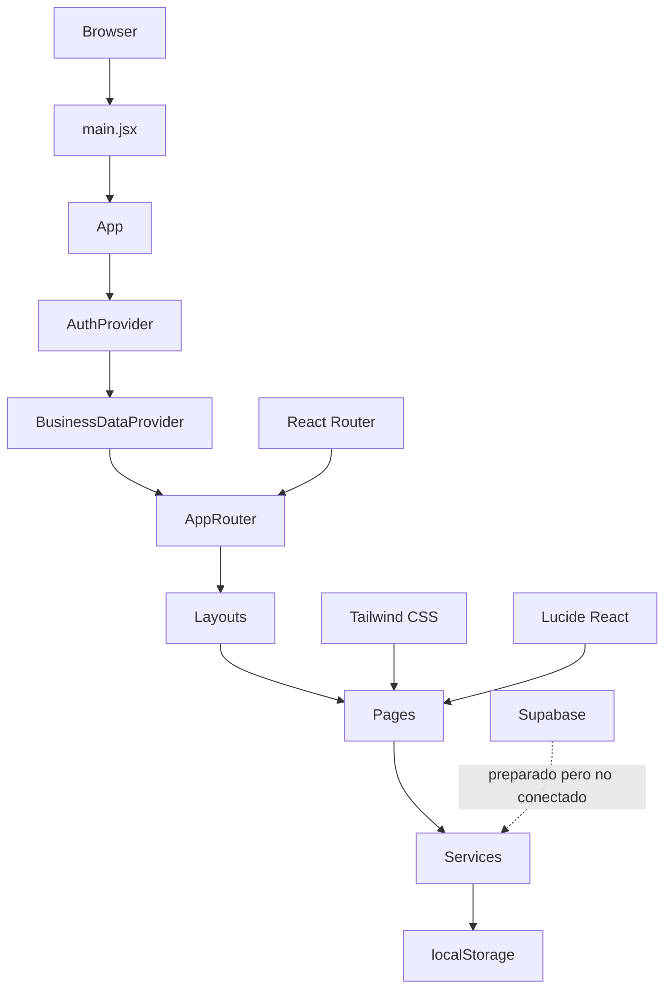
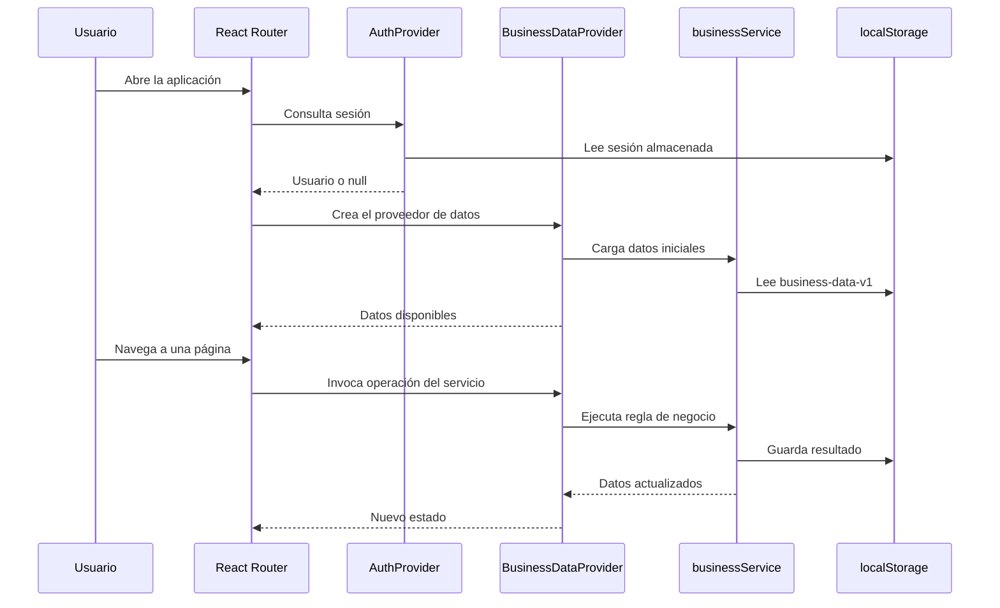
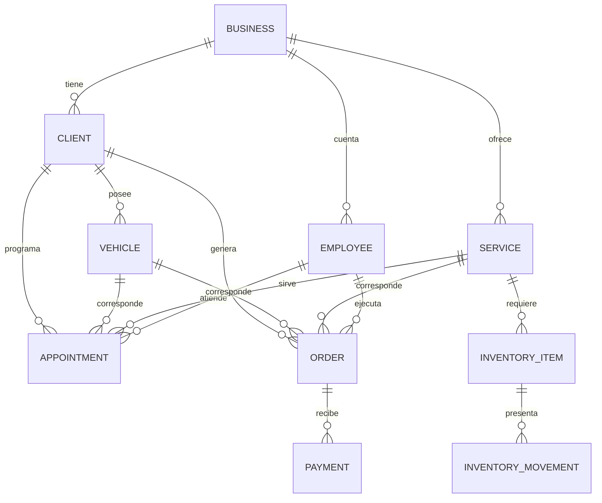

# Arquitectura y diseño del proyecto

## 1.Resumen ejecutivo

Este proyecto es una aplicación web de gestión para lavaderos y centros de detailing. Está desarrollado con React 19, Vite 8 y Tailwind CSS 4. La aplicación usa React Router para navegar y un proveedor de datos local para gestionar clientes, vehículos, servicios, órdenes, inventario, agenda, empleados, caja y configuración.

El proyectoActualmente es una implementación de demostración. Los datos se persisten en `localStorage`, y la autenticación no conecta a Supabase ni a otro backend.

## 2.Objetivo de la aplicación

La aplicación permite:

- Registrar y administrar clientes y vehículos.
- Consultar el estado de un vehículo mediante un código único.
- Crear y gestionar servicios y recetas de inventario.
- Programar citas y convertirlas en órdenes.
- Administrar el ciclo de vida de las órdenes.
- Controlar stock, consumos y movimientos de inventario.
- Registrar métodos de pago y confirmar pagos.
- Generar reportes de negocio.
- Gestionar empleados y sus tareas.
- Separar el acceso de administradores y empleados.

## 3. Tecnologías

| Área | Tecnología |
|---|---|
| UI | React 19.3 |
| Build | Vite 8.3 |
| Routing | React Router DOM 7.18 |
| Estilos | Tailwind CSS 4.3 |
| Icons | Lucide React |
| State | Contexto React y estado local |
| Persistencia | localStorage |
| Authentication | Proveedor local de demostración |
| Database | Supabase se encuentra preparado, pero no integrado |
| Lint | ESLint 10 |
| Compiler | React Compiler mediante Vite y Babel |

## 4. Estructura del proyecto

```text
.
├── eslint.config.js
├── index.html
├── package.json
├── vite.config.js
├── README.md
├── PROYECTO_ARQUITECTURA_Y_DISENO.md
├── public/
├── src/
│   ├── App.css
│   ├── App.jsx
│   ├── index.css
│   ├── main.jsx
│   ├── app/
│   │   ├── App.jsx
│   │   ├── AppRouter.jsx
│   │   └── routes.js
│   ├── components/
│   │   ├── layout/
│   │   │   ├── Header.jsx
│   │   │   ├── MobileNavigation.jsx
│   │   │   ├── NavigationItem.jsx
│   │   │   └── Sidebar.jsx
│   │   ├── shared/
│   │   │   ├── MetricCard.jsx
│   │   │   ├── Modal.jsx
│   │   │   └── StatusBadge.jsx
│   │   └── ui/
│   │       ├── Button.jsx
│   │       ├── SelectField.jsx
│   │       └── TextField.jsx
│   ├── features/
│   │   └── auth/
│   │       ├── AuthContext.jsx
│   │       ├── authContext.js
│   │       └── useAuth.js
│   ├── hooks/
│   │   ├── BusinessDataProvider.jsx
│   │   ├── businessDataContext.js
│   │   └── useBusinessData.js
│   ├── layouts/
│   │   ├── AuthLayout.jsx
│   │   ├── DashboardLayout.jsx
│   │   └── PublicLayout.jsx
│   ├── lib/
│   │   └── formatters.js
│   ├── pages/
│   │   ├── Agenda/
│   │   ├── Cash/
│   │   ├── Clients/
│   │   ├── Dashboard/
│   │   ├── Employees/
│   │   ├── Inventory/
│   │   ├── Login/
│   │   ├── Orders/
│   │   ├── PublicVehicle/
│   │   ├── Reports/
│   │   ├── Services/
│   │   └── Settings/
│   ├── services/
│   │   └── businessService.js
│   ├── styles/
│   └── theme/
│       ├── colors.js
│       ├── radius.js
│       ├── shadows.js
│       ├── spacing.js
│       └── typography.js
└── supabase/
    ├── seed.sql
    ├── functions/
    └── migrations/
```

## 5. Diagrama de arquitectura



## 6. Flujo de ejecución



## 7. Rutas y permisos

| Ruta | Función | Acceso |
|---|---|---|
| `/login` | Inicio de sesión | Público |
| `/` | Redirección al dashboard | Autenticado |
| `/dashboard` | Resumen del negocio | Administrador y empleado |
| `/agenda` | Agenda de citas | Administrador y empleado |
| `/clients` | Clientes y vehículos | Administrador y empleado |
| `/services` | Servicios y recetas | Administrador y empleado |
| `/orders` | Órdenes y tareas | Administrador y empleado |
| `/inventory` | Inventario y stock | Administrador |
| `/cash` | Caja y pagos | Administrador |
| `/reports` | Reportes | Administrador |
| `/employees` | Gestión de empleados | Administrador |
| `/settings` | Configuración de negocio | Administrador |
| `/consulta` | Consulta pública de vehículo | Público |

El router está definido en [src/app/AppRouter.jsx](src/app/AppRouter.jsx). Los permisos se aplican en la ruta de administración y en las operaciones del servicio.

## 8. Layouts

### Layout de autenticación

El layout de login presenta una pantalla centrada con:

- Fondo oscuro.
- Gradientes azul y azul eléctrico.
- Rejilla de puntos sutil.
- Logo con icono de gotas.
- Título principal y subtítulo.
- Contenedor de formulario centrado.
- Nota indicando modo de demostración.

Está implementado en [src/layouts/AuthLayout.jsx](src/layouts/AuthLayout.jsx).

### Layout de dashboard

El dashboard usa una distribución de tres columnas en escritorio:

- Sidebar fijo a la izquierda.
- Header fijo en la parte superior.
- Área de contenido scrollable.
- Navegación móvil con barra inferior y menú lateral.

La estructura se encuentra en [src/layouts/DashboardLayout.jsx](src/layouts/DashboardLayout.jsx).

### Layout público

La consulta de vehículo usa un header pequeño y una superficie central con ancho máximo de 480 píxeles. Está implementado en [src/layouts/PublicLayout.jsx](src/layouts/PublicLayout.jsx).

## 9. Diseño visual

### Paleta principal

| Token | Valor |
|---|---|
| Fondo | `#05070A` |
| Superficie | `#0D1117` |
| Superficie secundaria | `#151B23` |
| Texto principal | `#F8FAFC` |
| Texto secundario | `#94A3B8` |
| Borde | `#1E293B` |
| Azul eléctrico | `#008CFF` |
| Azul hover | `#0074D9` |
| Fondo claro | `#F8FAFC` |
| Superficie clara | `#FFFFFF` |
| Texto claro | `#0F172A` |

Los tokens se definen en [src/index.css](src/index.css). Tailwind los expone como `canvas`, `surface`, `surface-secondary`, `foreground`, `muted`, `outline` y `brand`.

### Estilos globales

- Fuente: Inter, system-ui y sans-serif.
- Color de esquema oscuro por defecto.
- Altura mínima de 100vh.
- Animación de enfoque por teclado.
- Bordes redondeados con clases Tailwind.
- Contenidos responsive.
-.scrollbars personalizados.
- Diseño de alto contraste para usuarios con accesibilidad.

### Componentes visuales recurrentes

- Tarjetas de métricas.
- Contenedores de sección.
- Filtros y buscadores.
- Tablas y tarjetas de datos.
- Modales.
- Badges de estado.
- Botones primarios y secundarios.
- Campos de texto, correo y selección.
- Mensajes de éxito, error y vacío.

## 10. Componentes compartidos

| Componente | Responsabilidad |
|---|---|
| `Button` | Botón principal, secundario y compatibilidad con atributos HTML. |
| `TextField` | Campo de texto con etiqueta, icono, error y descripción. |
| `SelectField` | Campo de selección con icono y estado de error. |
| `MetricCard` | Tarjeta de metricas con icono, valor y enlace opcional. |
| `StatusBadge` | Etiqueta de estado de negocio. |
| `Modal` | Ventana modal accesible con cierre. |
| `Sidebar` | Navegación por rol. |
| `Header` | Título de página, usuario y cerrar sesión. |
| `MobileNavigation` | Navegación móvil y menú adicional. |
| `NavigationItem` | Elemento de navegación con estado activo. |

## 11. Modelo de datos



### Entidades principales

| Entidad | Campos principales |
|---|---|
| Business | Identificador, nombre, contacto, dirección y configuración. |
| Client | Nombre, teléfono, dirección, activo y fecha de creación. |
| Vehicle | Placa, tipo, marca, modelo, color, código de consulta y cliente. |
| Service | Nombre, categoría, descripción, precio, duración y receta. |
| Employee | Nombre, correo, rol, activo y fecha de ingreso. |
| Appointment | Cliente, vehículo, servicio, empleado, fecha, hora y estado. |
| Order | Número, cliente, vehículo, servicio, empleado, precio y estado. |
| Payment | Orden, método, estado y fecha de confirmación. |
| InventoryItem | Nombre, categoría, stock, mínimo, costo y activo. |
| InventoryMovement | Insumo, cantidad, tipo y fecha. |
| Activity | Evento de negocio, descripción y referencia. |

## 12. Implementación de autenticación

El proveedor de autenticación está en [src/features/auth/AuthContext.jsx](src/features/auth/AuthContext.jsx).

Flujo:

1. Lee la sesión almacenada en `localStorage` o `sessionStorage`.
2. Valida que el rol sea `admin` o `employee`.
3. Crea un usuario con nombre, correo, rol y empleado asociado.
4. Guarda la sesión Según la opción de recuerdo.
5. Expone `user`, `login` y `logout` mediante Context.

El hook de acceso está en [src/features/auth/useAuth.js](src/features/auth/useAuth.js).

> ⚠️ Actualmente el login es completamente local. No existe autenticación de contraseña, credenciales, hashes ni conexión a Supabase.

## 13. Implementación de datos

El proveedor de datos está en [src/hooks/BusinessDataProvider.jsx](src/hooks/BusinessDataProvider.jsx).

El flujo es:

1. Carga el estado inicial de negocio.
2. El consumidor solicita una operación desde el contexto.
3. El proveedor invoca una función de [src/services/businessService.js](src/services/businessService.js).
4. El servicio ejecuta validación y reglas de negocio.
5. El proveedor actualiza el estado.
6. El servicio persiste el estado en `localStorage`.

Las operaciones se centran en una única fuente de verdad: el estado completo del negocio.

## 14. Reglas de negocio

### Clientes

- El nombre debe existir.
- El teléfono es obligatorio.
- Un cliente no puede eliminarse si tiene vehículos u órdenes.
- La éliminación puede realizarse mediante desactivación.
- Los campos `document` y `email` se eliminan del modelo de cliente.

### Vehículos

- La placa es obligatoria.
- El tipo debe ser Moto, Carro o Camioneta.
- La placa debe ser única.
- El código de consulta se genera con `crypto.getRandomValues`.
- El código se conserva al editar el vehículo.
- La consulta pública busca por código, no por placa.
- El historial se filtra por `vehicleId`.

### Servicios

- El precio y la duración deben ser válidos.
- La receta debe contener insumos activos.
- No se permiten duplicados en la receta.
- Las cantidades deben ser positivas.

### Órdenes

- Solo el administrador puede crear o administrar todas las órdenes.
- Un empleado puede actualizar únicamente su propia orden.
- El estado debe seguir una transición válida.
- El stock se descuenta solo al completar una orden.
- El pago requiere confirmación administrativa.

### Agenda

- La cita debe tener cliente, vehículo, servicio, empleado, fecha y hora.
- La fecha debe ser futura.
- No se permite solapamiento para el mismo trabajador.
- Solo el administrador puede crear, editar o cancelar citas.

## 15. Consulta pública de vehículos

La página está en [src/pages/PublicVehicle/index.jsx](src/pages/PublicVehicle/index.jsx).

Flujo:

1. El usuario introduce un código de consulta.
2. La página filtra vehículos activos por código.
3. Muestra cliente, vehículo, servicio y estado de la última operación.
4. Si no existe, muestra un mensaje de no encontrado.

La consulta no exige autenticación.

## 16. Funciones principales del servicio

| Función | Responsabilidad |
|---|---|
| `createClient` | Crea cliente y vehículos asociados. |
| `updateClient` | Actualiza cliente. |
| `createVehicle` | Crea vehículo. |
| `updateVehicle` | Actualiza vehículo. |
| `createAppointment` | Crea cita validada. |
| `updateAppointment` | Reprograma cita. |
| `cancelAppointment` | Cancela cita. |
| `createOrder` | Crea orden. |
| `createOrderFromAppointment` | Convierte una cita en orden. |
| `transitionOrder` | Cambia estado y ejecuta stock y actividades. |
| `declarePaymentMethod` | Registra método pendiente de confirmación. |
| `confirmPayment` | Confirma pago administrativo. |
| `saveService` | Guarda servicio y receta. |
| `saveEmployee` | Guarda empleado. |
| `saveInventoryItem` | Guarda inventario. |
| `updateBusiness` | Guarda configuración del negocio. |

## 17. Rutas y componentes por módulo

| Módulo | Página | Componentes principales |
|---|---|---|
| Dashboard | [src/pages/Dashboard/index.jsx](src/pages/Dashboard/index.jsx) | Métricas, activity feed y resumen. |
| Agenda | [src/pages/Agenda/index.jsx](src/pages/Agenda/index.jsx) | Calendario, cita y formulario. |
| Clientes | [src/pages/Clients/index.jsx](src/pages/Clients/index.jsx) | Lista, detalle, cliente y vehículos. |
| Servicios | [src/pages/Services/index.jsx](src/pages/Services/index.jsx) | Catálogo, recetas y formulario. |
| Órdenes | [src/pages/Orders/index.jsx](src/pages/Orders/index.jsx) | Estados, tareas y método de pago. |
| Inventario | [src/pages/Inventory/index.jsx](src/pages/Inventory/index.jsx) | Stock, movimientos y formulario. |
| Caja | [src/pages/Cash/index.jsx](src/pages/Cash/index.jsx) | Pagos y confirmaciones. |
| Reportes | [src/pages/Reports/index.jsx](src/pages/Reports/index.jsx) | Reportes de ingresos y actividad. |
| Empleados | [src/pages/Employees/index.jsx](src/pages/Employees/index.jsx) | Empleados y tareas asignadas. |
| Configuración | [src/pages/Settings/index.jsx](src/pages/Settings/index.jsx) | Datos de negocio y logo. |
| Consulta | [src/pages/PublicVehicle/index.jsx](src/pages/PublicVehicle/index.jsx) | Búsqueda y estado del vehículo. |

## 18. Persistencia

La persistencia actual usa dos claves:

- `lavadero-mock-session`: sesión de autenticación.
- `lavadero-business-data-v1`: datos completos del negocio.

La información personal y de identificación se evita en el modelo de clientes y vehículos. El código de consulta es la única referencia pública para localizar un vehículo.

## 19. Configuración de desarrollo

```json
{
  "scripts": {
    "dev": "vite",
    "build": "vite build",
    "lint": "eslint .",
    "preview": "vite preview"
  }
}
```

El servidor se inicia con:

```powershell
npm run dev
```

La compilación de producción se genera con:

```powershell
npm run build
```

## 20. Despliegue

La aplicación puede desplegarse en cualquier hosting estático que soporte Vite, como:

- Netlify.
- Vercel.
- Azure Static Web Apps.
- GitHub Pages.
- Hosting web privado.

No puede considerarse producción hasta reemplazar el almacenamiento local por Supabase o un backend gestionado.

## 21. Riesgos actuales

| Riesgo | Impacto | Estado |
|---|---|---|
| Autenticación local falsa | Impersonación de roles | Alto |
| Datos en localStorage | Pérdida o alterable por el usuario | Alto |
| Sin backend | No persistencia segura ni multiusuario | Alto |
| Selector de rol | El usuario puede elegir administrador | Alto |
| React Compiler duplicado | Inestabilidad o rendimientos variables | Medio |
| Plantilla de Vite | Código muerto | Bajo |
| Sin pruebas automatizadas | Regresiones no detectadas | Alto |
| Sin Git | No hay historial ni control de versiones | Alto |
| Dependencias de desarrollo | Build lento | Bajo |

## 22. Recomendaciones de producción

1. Integrar Supabase con autenticación real.
2. Guardar sesiones y datos en PostgreSQL.
3. Aplicar políticas de autorización en el backend.
4. Eliminar el selector de rol.
5. Aprovechar la configuración de RLS de Supabase.
6. Ejecutar todas las operaciones desde el servidor.
7. Eliminar el proveedor de datos local.
8. Activar pruebas unitarias y de integración.
9. Añadir un error boundary y páginas 404.
10. Eliminar el código de Vite sin uso.
11. Simplificar la configuración de React Compiler.
12. Revisar la carga de producción y los tiempos de renderizado.

## 23. Conclusión

El proyecto ya contiene una arquitectura funcional y consistente para un entorno de demostración. La capa de UI, routing, estado y reglas de negocio está bien estructurada y utiliza componentes reutilizables y diseños responsivos.

La implementación es adecuada para validar características y presentar una interfaz, pero no está preparada para producción. El principal bloqueador es la autenticación y persistencia: actualmente el sistema no protege los datos ni garantiza la identidad de los usuarios.
